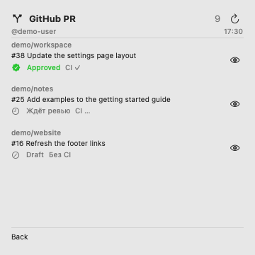

# GitHub PR Widget for macOS

Your open pull requests in Notification Center, grouped by repository. Check reviews, CI and unread comments, hide individual PRs under **More**, and refresh without opening a browser.

[Русская инструкция](docs/README.ru.md)

| Open pull requests | Hidden under More |
| --- | --- |
|  |  |

These previews render the actual SwiftUI widget with fictional accounts, repositories and pull requests from [`Examples/`](Examples). The current interface is primarily in Russian, with English labels such as Approved and More.

## What it does

- Finds open PRs authored by the active GitHub CLI account across repositories that account can access on **github.com**.
- Shows review status, CI status and new comments, including comments from bots and published reviews.
- Groups repositories by the most recent commit in their open PRs, newest first. Within a repository, PR numbers are descending.
- Keeps hidden PRs under **More**. Use **Back** to return, or the eye button to restore a PR.
- Paginates the list inside the widget. Repeated clicks at the first or last page keep that page selected.
- Refreshes every **30 minutes** while the app is running, with manual refresh in both the app and widget.
- Remembers hidden PRs and read comments separately for each account.

## Requirements

- An **Apple Silicon** Mac running **macOS 14 or newer**. Intel builds are not provided by the scripts.
- **Full Xcode**, compatible with your macOS version. The build has been tested with Xcode 16.2. Command Line Tools alone cannot produce the App Intents metadata needed for interactive widget buttons.
- **GitHub CLI (`gh`)**, signed in to the account whose PRs you want to see.
- Python 3 for build metadata checks, available with the development tools.

This is a source distribution with local ad-hoc signing. Build it on the Mac where you will use it. No paid Apple Developer membership is needed for this local build; there is no notarized download or App Store release.

## Install

1. Install Xcode from Apple, open it once, and complete its first-launch setup and license prompts. Put it in `/Applications/Xcode.app` or `~/Applications/Xcode.app`; for another location, set `DEVELOPER_DIR` to its `Contents/Developer` directory.
2. Install GitHub CLI using the [official installation instructions](https://cli.github.com/). With Homebrew already installed:

   ```sh
   brew install gh
   gh auth login --hostname github.com --web
   gh auth status --hostname github.com
   gh api user --jq .login
   ```

   The last command should print your intended account. If you use multiple saved accounts, switch with `gh auth switch --hostname github.com --user YOUR_LOGIN`.

3. Clone and build:

   ```sh
   git clone https://github.com/yudin-s/github-pr-widget.git
   cd github-pr-widget
   bash scripts/test.sh
   bash scripts/build-xcode.sh
   bash scripts/install.sh
   open "$HOME/Applications/GitHub PR.app"
   ```

4. Let the first sync finish. Click the date and time in the macOS menu bar → **Edit Widgets** → **GitHub PR** → add the **large** widget.
5. In the app's settings, enable **Запускать при входе в macOS** if you want it to start when you log in.

Closing the window leaves the app running in the menu bar. Choosing **Завершить GitHub PR** quits it and stops automatic refresh. After sleep, the next overdue refresh runs when the app wakes. macOS controls when the widget redraws, so the time shown is the last successful sync, not a promise of exact refresh timing.

## Using the widget

| Control | Action |
| --- | --- |
| PR title | Opens the PR in your browser; does not mark comments read |
| Blue comment count | Marks the comments in the displayed snapshot as read |
| Crossed-out eye | Hides the PR under More |
| Eye in More | Restores the PR to the main list |
| More / Back | Switches between the main and hidden lists |
| Left / right arrows | Changes pages inside the widget |
| Refresh arrow | Requests a new sync; may open the app to run `gh` |

The first successful sync treats existing comments as read. Later comment IDs count as unread until you mark them read. Your own comments and pending reviews are excluded. Pushing commits does not itself mark comments as read.

**Approved** uses GitHub's review decision when available. If GitHub returns no aggregate decision, the app uses the latest effective approval or change request per reviewer; dismissed reviews do not count. **Ждёт ревью** means there is no current decision, including when a new review is awaited. Approval alone does not establish merge readiness; CI and repository rules still apply.

## Authentication and local data

The app uses the saved GitHub CLI session. It removes `GH_TOKEN`, `GITHUB_TOKEN`, `GH_HOST` and `GH_DEBUG` from the child process environment. Authenticate with `gh auth login`; an environment-only token is not used. GitHub Enterprise hosts are not supported by this version.

The app makes read-only GitHub queries. Hiding PRs and marking comments read change only local state. No token is copied into the widget snapshot. The app runs outside the macOS sandbox to execute `gh`; the widget is sandboxed with access to the app's state directory:

```text
~/Library/Application Support/GitHub PR/PRState/
```

The snapshot contains account names, PR titles, repository names and comment IDs. Keep it private; do not commit or share it as a sample. Failed requests preserve the previous snapshot. A damaged snapshot is reported as an error instead of silently resetting read state.

## Update or uninstall

To update, quit GitHub PR from its menu bar menu, pull the latest source, rebuild, and run the installer again. The installer refuses to replace a running app or an unrelated app with the same name. Updating preserves local state.

To uninstall, disable launch at login, quit the app, remove its widget, and move `~/Applications/GitHub PR.app` to the Trash. You can also remove the state directory above if you want to discard hidden/read preferences. GitHub CLI authentication is managed separately.

## Troubleshooting

- **The widget is missing:** run the installed app once, check that the build completed, then reopen Edit Widgets. The installer registers the extension with `pluginkit`.
- **Buttons open the app instead of changing pages:** rebuild with full Xcode using `scripts/build-xcode.sh`. It validates App Intents metadata before installation. Refresh and PR links intentionally open the app or browser.
- **Wrong account or missing repositories:** check `gh auth status --hostname github.com` and `gh api user --jq .login`, switch accounts if needed, then refresh. The account must have access to the repository; organizations may also require SSO authorization.
- **Stale data:** keep the app running. Check its error message and last successful sync time. Network failures and API rate limits can delay updates.
- **Build tools cannot be found:** complete Xcode's first-launch setup and check `DEVELOPER_DIR`. Use an Xcode version supported by your macOS installation.

## Development and verification

```sh
bash scripts/test.sh      # Standalone Swift checks; does not contact GitHub
bash scripts/verify.sh    # Checks, native build, signatures, App Intents metadata
bash scripts/preview.sh   # Renders fictional examples into build/previews/
```

The tests cover comment baselines, account isolation, concurrent state writes, pagination, commit ordering, GitHub response pagination, review fallback, refresh scheduling and subprocess handling. Notification Center rendering and button behavior still need a manual check on the installed app.

The app uses SwiftUI, WidgetKit and App Intents. `Sources/PRCore` owns persisted state and pagination, `Sources/PRGitHub` handles `gh` and sync scheduling, and `Shared` holds the bridge between the app and widget. There are no third-party Swift dependencies.

## License

[MIT](LICENSE) © 2026 Serge Yudin.
