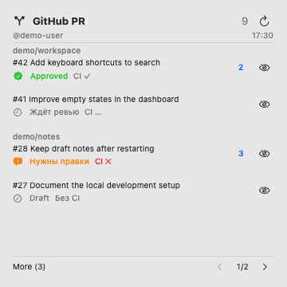

# GitHub PR для macOS

Нативное приложение и большой виджет центра уведомлений: ваши открытые PR по репозиториям, статусы ревью и CI, новые комментарии и скрытые PR в More.

[English documentation](../README.md)



На изображении настоящий SwiftUI-интерфейс с вымышленными данными из `Examples/`. Интерфейс преимущественно на русском; часть обозначений, например Approved и More, на английском.

## Установка и настройка

Нужны Apple Silicon Mac, macOS 14+, полный Xcode, совместимый с вашей macOS, GitHub CLI и Python 3 из инструментов разработчика. Сборка проверена с Xcode 16.2. Одних Command Line Tools недостаточно для интерактивных кнопок виджета.

1. Установите Xcode из официального источника Apple, откройте его и завершите первоначальную настройку. Поддерживается расположение `/Applications/Xcode.app` или `~/Applications/Xcode.app`. Для другого пути задайте `DEVELOPER_DIR`, указывающий на `Contents/Developer` внутри Xcode.
2. Установите GitHub CLI по [официальной инструкции](https://cli.github.com/). Если Homebrew уже установлен:

   ```sh
   brew install gh
   gh auth login --hostname github.com --web
   gh auth status --hostname github.com
   gh api user --jq .login
   ```

   Последняя команда должна показать нужный аккаунт. Для переключения между сохранёнными аккаунтами: `gh auth switch --hostname github.com --user YOUR_LOGIN`.

3. Скачайте исходники, соберите и установите приложение:

   ```sh
   git clone https://github.com/yudin-s/github-pr-widget.git
   cd github-pr-widget
   bash scripts/test.sh
   bash scripts/build-xcode.sh
   bash scripts/install.sh
   open "$HOME/Applications/GitHub PR.app"
   ```

4. Дождитесь первой загрузки PR. Нажмите на дату справа в строке меню macOS → «Изменить виджеты» → GitHub PR → добавьте большой виджет.
5. При желании включите «Запускать при входе в macOS» в настройках приложения.

Приложение подписывается локально, поэтому собирайте его на том Mac, где будете использовать. Платное членство Apple Developer для такой сборки не требуется. Готового нотарифицированного дистрибутива и версии App Store нет; скрипты не предоставляют сборку для Intel.

## Как пользоваться

- Репозитории отсортированы по дате последнего коммита среди ваших открытых PR, от свежих к старым. При равенстве — по имени, внутри репозитория — по номеру PR по убыванию.
- Перечёркнутый глаз скрывает PR в More. Обычный глаз возвращает его. More/Back и стрелки меняют список и страницу внутри карточки.
- Нажатие на название открывает PR в браузере и не сбрасывает счётчик комментариев.
- Синий счётчик отмечает показанные комментарии прочитанными. Первоначальная загрузка считает старые комментарии прочитанными; последующие новые ID учитываются, включая комментарии ботов. Собственные комментарии и неопубликованные ревью исключаются. Push сам по себе не отмечает комментарии прочитанными.
- Approved показывает решение GitHub; если агрегированного решения нет, учитываются последние действующие решения ревьюеров. Отозванный апрув не учитывается. «Ждёт ревью» означает отсутствие текущего решения. Апрув не гарантирует готовность к merge.
- Обновление выполняется каждые 30 минут, пока приложение работает. Ручное обновление доступно в приложении и виджете. Кнопка обновления виджета может открыть приложение для запроса через `gh`.

Закрытие окна оставляет приложение в строке меню. «Завершить GitHub PR» останавливает автоматическое обновление. После сна выполняется просроченный запрос. Время перерисовки карточки контролирует macOS; показанное время — последняя успешная синхронизация. Сбой сети сохраняет предыдущие данные.

## Авторизация и данные

Используется сохранённая авторизация `gh` на github.com. Переменные `GH_TOKEN`, `GITHUB_TOKEN`, `GH_HOST` и `GH_DEBUG` исключаются из дочернего процесса. Вход только через переменную окружения не используется; выполните `gh auth login`. GitHub Enterprise не поддерживается.

Запросы к GitHub только читают данные. Скрытие PR и отметки прочитанного меняют локальное состояние отдельно для каждого аккаунта. Токен не копируется в снимок. Приложение работает вне sandbox для запуска `gh`; виджет работает в sandbox с доступом к своей папке состояния:

```text
~/Library/Application Support/GitHub PR/PRState/
```

Там хранятся имена аккаунтов, репозиториев, заголовки PR и ID комментариев. Не публикуйте этот файл как пример. При повреждении снимка приложение показывает ошибку, а не сбрасывает состояние молча.

## Обновление и удаление

Перед обновлением завершите приложение через меню, выполните `git pull`, пересоберите и снова запустите `scripts/install.sh`. Состояние сохраняется. Установщик откажется заменять работающее приложение или другое приложение с тем же именем.

Для удаления отключите запуск при входе, завершите приложение, уберите виджет и перенесите `~/Applications/GitHub PR.app` в Корзину. Папку состояния можно удалить отдельно, если больше не нужны настройки. Авторизация GitHub CLI управляется отдельно.

## Если что-то не работает

- **Виджет не появился:** запустите установленное приложение, убедитесь, что сборка завершилась успешно, затем снова откройте «Изменить виджеты».
- **Кнопки вместо переключения открывают окно:** пересоберите через `bash scripts/build-xcode.sh` с полным Xcode. Скрипт проверяет наличие метаданных App Intents. Открытие приложения кнопкой обновления предусмотрено.
- **Не тот аккаунт или не все репозитории:** проверьте `gh auth status --hostname github.com` и `gh api user --jq .login`, переключите аккаунт и обновите. Для организаций может потребоваться отдельная авторизация SSO.
- **Данные устарели:** приложение должно работать. Проверьте его сообщение об ошибке и время последней синхронизации; сеть и лимиты API могут задержать загрузку.

Проверка сборки: `bash scripts/verify.sh`. Нейтральные превью: `bash scripts/preview.sh`. Эти проверки не заменяют проверку кнопок в установленном виджете центра уведомлений.

## Лицензия

[MIT](../LICENSE) © 2026 Serge Yudin.
